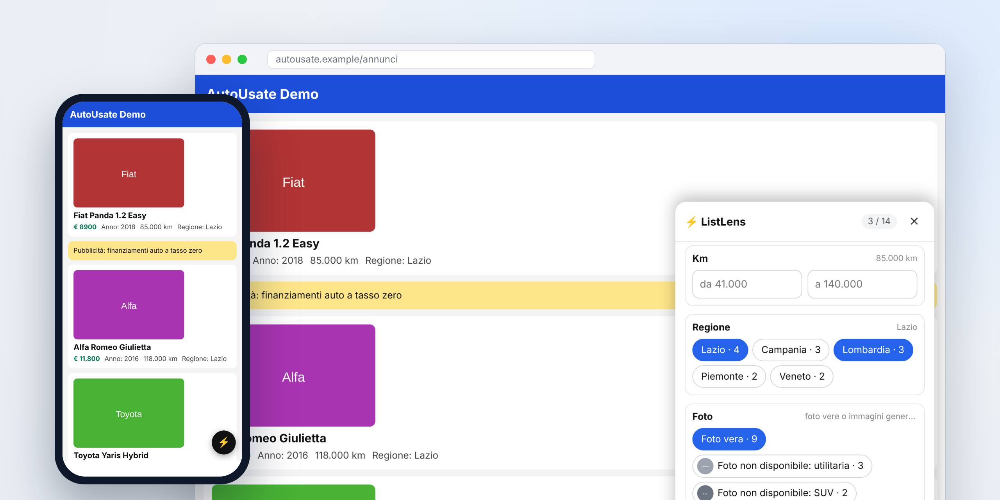

# ListLens

🇬🇧 [English version](README.md)

**Filtri e ordinamento su qualsiasi lista di qualsiasi sito, anche quando il sito non li offre.**



Molti siti mostrano un elenco (annunci, prodotti, offerte) senza filtri né ordinamento. Con ListLens tocchi un elemento della lista: lui riconosce la struttura, legge i campi (prezzo, anno, regione, foto…) e ti dà subito filtri e ordinamento. Funziona sul sito vero, direttamente nella tua pagina, senza server e senza account. Le modifiche restano solo sul tuo dispositivo.

👉 **Pagina di installazione con lista di prova:** https://andrea6687.github.io/ListLens/
Copia il segnalibro con un tocco e provalo subito sulla lista di esempio.

## Installazione rapida

### Telefono (iPhone, iPad, Android)

Sul telefono ListLens si usa come segnalibro del browser. Non si installa niente.

1. **Copia il codice.** Dal telefono apri la [pagina di installazione](https://andrea6687.github.io/ListLens/) e tocca **Copia bookmarklet**. In alternativa apri [`bookmarklet.txt`](bookmarklet.txt) e tocca il pulsante **Copia** (Copy raw file). Il codice è un'unica riga lunga che inizia con `javascript:` e va copiato per intero.
2. **Crea il segnalibro.** Salva nei preferiti un sito qualsiasi, poi modifica quel preferito: come titolo scrivi `ListLens` e al posto dell'indirizzo incolla il codice.
   - **iPhone e iPad (Safari):** Condividi → Aggiungi segnalibro; poi icona dei Preferiti → Modifica → tocca il segnalibro.
   - **Android (Chrome o Firefox):** menu → aggiungi ai segnalibri; poi apri i segnalibri e scegli Modifica sul nuovo segnalibro.
3. **Usalo.** Sul sito con la lista apri i Preferiti e tocca **ListLens**. Su Chrome per Android scrivi invece `ListLens` nella barra dell'indirizzo e tocca il suggerimento con la stellina.

Quando ListLens viene aggiornato, ricopia il codice e sostituisci l'indirizzo del segnalibro. Filtri e ordine salvati non si perdono.

### Computer (Chrome, Edge, Firefox, Safari)

- **Segnalibro:** dalla [pagina di installazione](https://andrea6687.github.io/ListLens/) copia il codice, poi aggiungi alla barra dei preferiti un segnalibro chiamato `ListLens` e incolla il codice come indirizzo.
- **Estensione per Chrome ed Edge:** scarica o clona il repository, apri `chrome://extensions` (o `edge://extensions`), attiva **Modalità sviluppatore**, scegli **Carica estensione non pacchettizzata** e seleziona la cartella `extension/`. Con l'estensione filtri e ordine si riapplicano da soli quando riapri una pagina.

Firefox, Safari con Xcode, permessi e soluzioni ai problemi: [docs/INSTALL.md](docs/INSTALL.md).

## Come si usa

1. Avvia ListLens sulla pagina (segnalibro o icona dell'estensione) e tocca **Scegli la lista**.
2. Tocca un elemento qualsiasi della lista. ListLens evidenzia tutti gli elementi simili e ne estrae i campi.
3. Tocca **Conferma**. Per ogni campo ottieni il controllo adatto:
   - **valori ripetuti** (regione, carburante): chip da attivare, con il conteggio;
   - **numeri** (prezzo, anno, km): intervallo da/a. Legge i formati italiani come `€ 12.500` e `85.000 km`;
   - **testo libero**: ricerca;
   - **foto**: chip per mostrare solo gli annunci con una foto vera, oppure solo quelli con l'immagine generica di una categoria (per esempio "foto non disponibile"), ognuna con la sua miniatura.

   Un menu permette di ordinare per qualsiasi campo, crescente o decrescente.

I filtri e l'ordine vengono ricordati per pagina. Gli elementi che il sito aggiunge scorrendo, o che sostituisce cambiando pagina, vengono rilevati e filtrati.

## Privacy

ListLens non fa richieste di rete e non ha un server. Filtri e ordine sono salvati nella memoria locale del browser, sul tuo dispositivo. Il sito non viene modificato per nessun altro: cambia solo quello che vedi tu.

## Limiti noti

- Se un sito ridisegna la lista da solo (app React e simili) mantenendo gli stessi elementi, può annullare l'ordinamento. Gli elementi nuovi o sostituiti vengono invece rilevati.
- Funziona con liste dentro un unico contenitore. Pagine con più sezioni separate vanno scelte una alla volta.
- Alcuni siti con protezioni molto rigide possono bloccare l'avvio da segnalibro: in quel caso usa l'estensione.
- Le date non hanno ancora un controllo dedicato: si filtrano come testo.
- Il filtro foto legge solo le immagini vere e proprie (``), non quelle messe come sfondo con il CSS. Un'immagine è considerata generica quando compare identica in almeno due annunci, oppure quando il nome del file lo dice (`placeholder`, `no-image`, `nofoto`…). Le immagini generiche già riconosciute vengono ricordate.

## Sviluppo

```
npm install
npm test          # test automatici in jsdom
npm run build     # aggiorna extension/, bookmarklet.txt, index.html e crea dist/
```

```
src/listlens.js          il codice: rilevamento lista, campi, filtri, ordinamento, interfaccia
extension/               estensione Manifest V3 (popup di avvio, content script automatico, icone)
bookmarklet.txt          il codice del segnalibro, pronto da copiare (generato dalla build)
index.html               pagina di installazione pubblicata su GitHub Pages (generata dalla build)
demo/demo.html           pagina di prova con annunci di auto
docs/                    guida di installazione e modello della pagina di installazione
scripts/build.mjs        build
test/test.mjs            test automatici
```

I test girano in jsdom, non in un browser vero: dopo modifiche importanti conviene una prova a mano. Per contribuire leggi [CONTRIBUTING.md](CONTRIBUTING.md).

## Idee per dopo

- Controllo per le date e per i valori con unità diverse.
- Più liste nella stessa pagina e scelta del campo da mostrare nell'elenco.
- Userscript per Tampermonkey e per l'app Userscripts su Safari, senza passare da Xcode.
- Esportare la vista filtrata.

## Licenza

[MIT](LICENSE) © Andrea Sportello

---

Se ListLens ti ha risparmiato qualche minuto di scorrimento, una ⭐ al repository aiuta altre persone a trovarlo. Problemi e idee sono benvenuti nelle [issue](https://github.com/andrea6687/ListLens/issues).
