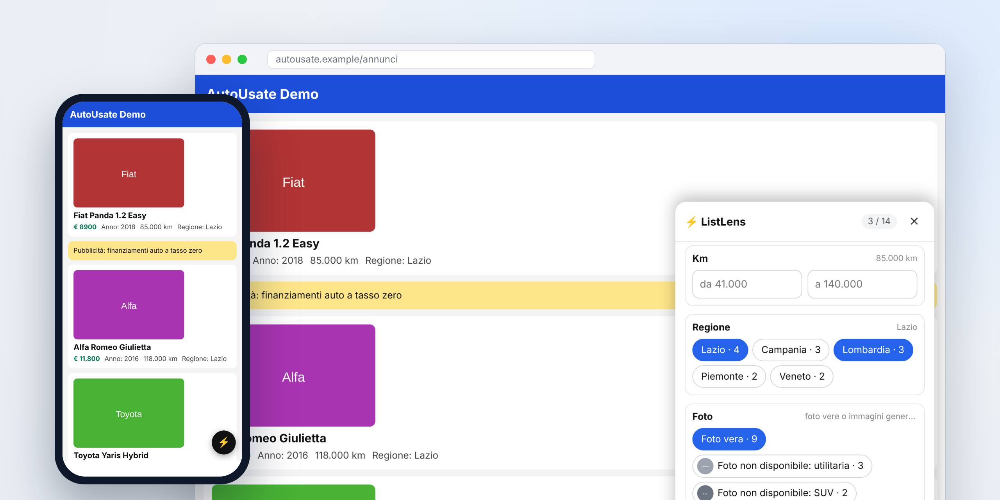

# ListLens

🇮🇹 [Versione italiana](README.it.md)

**Filter and sort any list on any website, even when the site doesn't let you.**



Many sites show a list (classified ads, products, deals) with no filters and no sorting. With ListLens you tap one item of the list: it recognizes the structure, reads the fields (price, year, region, photo…) and instantly gives you filters and sorting. It works on the real site, right inside your page, with no server and no account. Changes stay on your device only.

👉 **Install page with a demo list:** https://andrea6687.github.io/ListLens/
Copy the bookmarklet with one tap and try it right away on the sample list.

> The interface is in Italian for now, and numbers are read in the Italian format (`€ 12.500`, `85.000 km`).

## Quick install

### Phone (iPhone, iPad, Android)

On a phone ListLens is a browser bookmark. Nothing to install.

1. **Copy the code.** On your phone open the [install page](https://andrea6687.github.io/ListLens/) and tap **Copia bookmarklet** (copy bookmarklet). Or open [`bookmarklet.txt`](bookmarklet.txt) and tap the **Copy raw file** button. The code is one long line starting with `javascript:`, and it must be copied in full.
2. **Create the bookmark.** Bookmark any website, then edit that bookmark: name it `ListLens` and paste the code in place of the address.
   - **iPhone and iPad (Safari):** Share → Add Bookmark; then the Bookmarks icon → Edit → tap the bookmark.
   - **Android (Chrome or Firefox):** menu → add to bookmarks; then open your bookmarks and choose Edit on the new one.
3. **Use it.** On the site with the list, open your bookmarks and tap **ListLens**. On Chrome for Android, type `ListLens` in the address bar instead and tap the suggestion with the star.

When ListLens is updated, copy the code again and replace the bookmark's address. Your saved filters and sorting are kept.

### Computer (Chrome, Edge, Firefox, Safari)

- **Bookmarklet:** copy the code from the [install page](https://andrea6687.github.io/ListLens/), add a bookmark called `ListLens` to your bookmarks bar and paste the code as its address.
- **Chrome and Edge extension:** download or clone this repository, open `chrome://extensions` (or `edge://extensions`), turn on **Developer mode**, choose **Load unpacked** and select the `extension/` folder. With the extension, your filters and sorting are applied again automatically when you reopen a page.

Firefox, Safari with Xcode, permissions and troubleshooting: [docs/INSTALL.md](docs/INSTALL.md) (in Italian).

## How to use it

1. Start ListLens on the page (bookmark or extension icon) and tap **Scegli la lista** (pick the list).
2. Tap any item of the list. ListLens highlights all similar items and reads their fields.
3. Tap **Conferma** (confirm). Every field gets the right control:
   - **repeated values** (region, fuel): chips to toggle, with counts;
   - **numbers** (price, year, mileage): a from/to range;
   - **free text**: a search box;
   - **photo**: chips to show only the ads with a real photo, or only those with a category's generic image (for example "no photo available"), each with its thumbnail.

   A menu sorts by any field, ascending or descending.

Filters and sorting are remembered per page. Items the site adds as you scroll, or swaps in when you change page, are detected and filtered too.

## Privacy

ListLens makes no network requests and has no server. Filters and sorting are saved in the browser's local storage, on your device. The site isn't changed for anyone else: only what you see changes.

## Known limitations

- If a site redraws the list by itself (React apps and similar) keeping the same items, it can undo the sorting. New or replaced items are detected.
- It works with lists inside a single container. Pages with several separate sections must be picked one at a time.
- Some sites with very strict protections can block bookmarklets: use the extension there.
- Dates don't have a dedicated control yet: they are filtered as text.
- The photo filter reads real images (``), not CSS background images. An image counts as generic when the exact same one appears in at least two items, or when its file name says so (`placeholder`, `no-image`…). Generic images already recognized are remembered.

## Development

```
npm install
npm test          # automated tests in jsdom
npm run build     # updates extension/, bookmarklet.txt, index.html and creates dist/
```

```
src/listlens.js          the code: list detection, fields, filters, sorting, interface
extension/               Manifest V3 extension (launch popup, automatic content script, icons)
bookmarklet.txt          the bookmarklet code, ready to copy (generated by the build)
index.html               install page published on GitHub Pages (generated by the build)
demo/demo.html           demo page with used-car listings
docs/                    install guide and the install page template
scripts/build.mjs        build
test/test.mjs            automated tests
```

Tests run in jsdom, not in a real browser: after big changes a manual check is worth it. To contribute, read [CONTRIBUTING.md](CONTRIBUTING.md).

## License

[MIT](LICENSE) © Andrea Sportello

---

If ListLens saved you some scrolling, a ⭐ on the repository helps other people find it. Bugs and ideas are welcome in the [issues](https://github.com/andrea6687/ListLens/issues).
